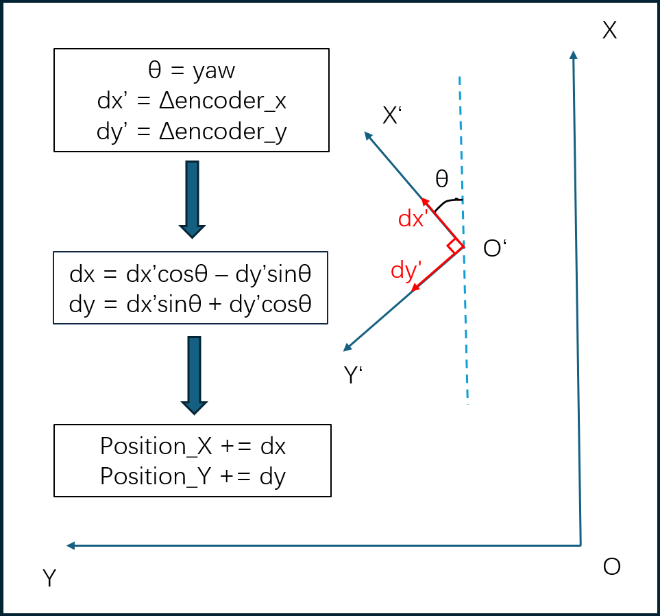

当前问题：

1、CAN通信有时候有波形，有时候没有，而且有波形的时候电脑端USB转CAN还收不到数据

可能是以下原因造成的：

1. 开了太多外设导致时序紊乱，所以我现在把main.c里的一些初始化注释掉了，到时候如果把这个问题解决了记得把那些解注释。
2. 软件上波特率等一些配置有点问题。

​	建议如果只测CAN的话，建议单开一个工程，只开CAN和TIM中断，看能不能发出去数据。

## LSM6DSV16X 和 MT6816 采样

TIM2 每 1 ms 触发一次采样，依次读取板载 LSM6DSV16X（SPI2 / PB12）、左侧 MT6816（SPI1 / PC1）和右侧 MT6816（SPI3 / PA0）。这里的 GPIO 引脚是各器件的片选。

三路共用 SPI_TransferWithCS()。每笔事务先设置传输长度、使能 SPI，使 Mode 3 的时钟回到高电平，然后拉低片选、启动时钟。接收完成后先释放片选，再关闭 SPI。函数用 DWT 周期计数器限制等待时间，可在 TIM2 中断中超时返回。MT6816 的角度高、低寄存器仍分次读取，偶校验包含弱磁状态位。

本板 SPI2 和 SPI3 使用 32 分频，关闭 MasterKeepIOState；PB13 开内部下拉，PA1 无上下拉。Keil 编译目标为 MDK-ARM/OPS10.uvprojx 中的 OPS10，烧录文件为 MDK-ARM/OPS10/OPS10.hex。

其他算法或者imu都已经测试过没问题了，上述问题如果解决了可以推回我的仓库，然后我整合一下应该就没什么问题了。

